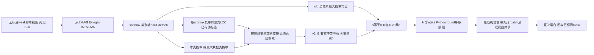

# TCSMix 控制设计：v2_B

本轮锁定**前景类别平衡概率间隔控制器v2_B**；映射端点、取整、随机位置及混合结构不变。状态等待正式训练确认，正式新版Dice/IoU/HD95/ASD均NA。旧Full90.35%仍属于old版本。时间2026-10-06T23:56:25.071207+08:00。

## 原路径与改动位置



原信号包含大量背景，连续s变化在97格内被取整吸收；未发现softmax维度/传值错误。旧Full150已记录步和旧E1全部3976已执行步都是97²，缺失Full迭代仍未知。新控制信号在原plab_a/plab_b已生成位置读取，不新增教师前向或伪标签后处理。

令P=detach(softmax(z,dim=1))，支持Ω_c为两组参考视图**原LCC处理后**预测为前景类c的全部有效像素并集，n_c=|Ω_c|。类别映射来自configs/ACDC_class_map.json（background0、RV1/MYO2/LV3）；核心函数按实际C与foreground_ids工作，已检查2/5类例子。

```text
m_c = (1/n_c) × Σ[v∈Ω_c] (P_c(v) − max[k≠c] P_k(v))
A = {c : n_c > 0}
q_B = (1/|A|) × Σ[c∈A] m_c   when |A| > 0
q_B = 0                       when |A| = 0
```

原支持是argmax类（LCC只移除区域），所以每个间隔数学上在[0,1]；代码只对浮点负误差作0下限，并拒绝与argmax不符的负间隔支持。背景不参与q；未出现类别跳过，不除零、不填1；无前景时q=0、s=.18、256²取46²。缺失类别不自动说明分割失败。没有额外阈值、温度、可学习分支、状态平滑或GT筛选。

仍s=.18+.20q，h=clamp(round(Hs),1,H−1)、w同理。s是边长比例，实际面积h*w/(H*W)，并非s。位置仍原np.random.randint上界exclusive约定，mask内0外1；一个mask共享批次/双视图，互补图像和目标同步。q与mask全程no_grad；CTW等损失和EMA维持原Full。

伪代码：

```python
P = cat([softmax(logits_a.detach(), dim=1),
         softmax(logits_b.detach(), dim=1)], dim=0)  # N,C,H,W
y = cat([existing_plab_a, existing_plab_b], dim=0)   # original LCC
class_margins = []
for c in configured_foreground_ids:
    support = (y == c)       # across BOTH equal-size unlabeled groups
    n_c = support.sum()
    if n_c > 0:
        others = [k for k in range(P.shape[1]) if k != c]
        margin = P[:, c] - P[:, others].amax(dim=1)
        class_margins.append(mean(margin[support]))
q = mean(class_margins) if class_margins else 0
s = 0.18 + 0.20*q
h, w = original_round_and_clamp(H*s, W*s)
mask = original_shared_random_rectangle(h, w)
```

## 候选取舍与真实诊断

先评估A=前景类别均衡mean(P_c)。70个固定离线batch（5来源×2模式×7批）中，old全部97；A总体91–95，但E1/3200与3976的train_snapshot每个7批都94，Full/29600每批都95。因这一阶段内剩余取整退化，仅离线比较一次B，不训练A、不调端点。B令两个E1快照各出现91/92、Full/29600出现92/93；Full/30000的train_snapshot仍全部93。取舍据前景/背景不变性、整数响应及简洁性，不读取测试分数或按Dice选方案。

所有70批：B尺寸86–94；train_snapshot35批最多93，最常见93占13/35=37.14%，old97占35/35=100%；eval35批最常见93占12/35=34.29%。这些混合了不同来源/时刻，不能误写为单一训练轨迹。实际240步新B短程才是新机制局部轨迹，85–90、88最多占38.75%、变化176次、fallback0；同一新版teacher回放old均97。变化不是效益证明。

来源：相同pretrain重建的SSL0教师（非留存step0快照）、E1均匀CTW教师3200/3976、旧Full教师29600/30000。Full中期检查点未保留，不能声称早/中/末完整覆盖。固定70样本：24索引等距无标注切片+6个无标注患者两端切片12张+原7标注患者14张+10验证患者20个frame中间切片；参考weak seed4261006，纯背景/缺类通过预测或已允许GT诊断标明，不用未标注GT挑片。eval和train_snapshot（每批恢复独立副本buffers、固定dropout）分别记录；静态回放不等于v2教师全程。

控制概率张量检查显示增加100个背景像素或改变类别像素数100:1，A/B保持同前景控制值，old改变；前景概率/间隔单调提高时q和整数尺寸单调非降。真实数据跨批背景占比与预测状态一起变化，不能仅凭散点称其完全背景无关。单样本回放只用于响应诊断，正式训练仍12张汇总；其中eval有10次fallback、train_snapshot2次，真实batch均无fallback，极小预测类唯一支持train_snapshot可只有1像素、eval可只有2像素，类均衡可放大其影响。原单切片回放调用signals(l,l)以复用双组信号，曾重复记录像素数；已将单样本计数除2，保留原表及修正receipt，概率/尺寸/质量未改。

GT只用于原标注/验证诊断，预测quality按相同LCC后的标签统计；fixed三前景macro双空类0，同时给GT-present-class Dice、GT类别数量和像素比例。不把切片/重复checkpoint当独立病例。例E1/3976 eval patient030_frame02:z5：q_B=.86061007，但三类macroDice=.40042189，真实前景类仅2/3、present-class Dice=.60063283；说明高间隔仍可能错误，不能叫校准正确率或轮廓可靠性。相关性表均为描述性，不能说明因果或用于候选挑选。

实现和范围见scripts/controller.py、reports/control_loop.patch、SCOPE_DIFF_AUDIT.md；针对性两方法比较与正式/预印本区别见REFERENCES_CN.md。控制器无状态，无新增模型参数或教师前向。正式收益目前未知，后续R1/R2单次正式实验尚待用户明确确认。
